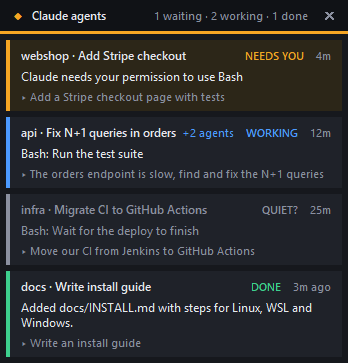

# Claude Agent Monitor

[](https://github.com/aggepap/claude-agent-monitor/actions/workflows/tests.yml)

A small floating, always-on-top window that lists every running Claude Code session and what it's doing.
No dependencies beyond Python and Tk.



| Card | Meaning |
|---|---|
| 🟠 **NEEDS YOU** | It asked a question or wants a permission (the window flashes and beeps) |
| 🔵 **WORKING** | Current step, e.g. `Bash: Run tests`, and how long since you sent the prompt |
| ⚪ **QUIET?** | Still "working" but nothing has happened for a while (10 min by default). Maybe stuck |
| 🟢 **DONE** | Finished; shows the start of its last reply |

`+2 agents` on a card means Claude has subagents running. The bar under the header takes the colour of the
most urgent session, so you can see the overall state even when the window is collapsed.

**Using it**

- **Click a card** to jump to that session's terminal.
- **Right-click a card** to dismiss it. It comes back if the session does anything new.
- **Drag the header** to move the window; **double-click** it to collapse.
- **Right-click the header** for the menu and **Settings…**

## Settings

Right-click the header → **Settings…**. Everything is saved automatically.

| Setting | Default |
|---|---|
| Desktop notification when a session needs you | Off |
| Desktop notification when a session finishes | Off |
| Play a sound / flash the header when a session needs you | On |
| Hide finished sessions | Off |
| Mark a session as quiet after N minutes without activity | 10 |
| Window opacity | 95% |

Notifications use the system's own notifications: `notify-send` on Linux (with an **Open** button that
jumps to the terminal), Notification Center on macOS, and Windows notifications on Windows/WSL. Use **Send a test notification** in
Settings to check them.

## Install

The folder is self-contained. Put it anywhere and run the installer with the Python of the system where Claude Code runs (WSL, Linux, macOS or Windows):

```bash
python3 install.py                 # sets up hooks + launchers
python3 install.py --no-autostart  # same, but don't open at login
python3 install.py uninstall
```

**Moved the folder?** Run `python3 install.py` again from the new place. It replaces the old paths.

Claude sessions that were already running pick up the hooks automatically; the window shows a session from its next event.

### WSL (window runs on Windows)

Needs Python for Windows (python.org, includes Tk). The installer adds **Claude Agent Monitor** to the Start Menu and the Startup folder.

### Windows (Claude Code running natively, without WSL)

Install Python from python.org, then in PowerShell or Git Bash:

```bash
python install.py
```

It registers the hook with that Python and adds Start Menu + Startup shortcuts.

### Native Ubuntu

Step-by-step guide, including autostart and Wayland setup: **[docs/UBUNTU.md](docs/UBUNTU.md)**. In short:

```bash
sudo apt install python3-tk tmux   # Tk for the window
python3 install.py
```

It adds **Claude Agent Monitor** to the app menu and to login autostart.

Click-to-open on Ubuntu:

- **tmux**: clicking selects that session's window and pane in the terminal showing it, or opens a new
  terminal window attached to it if none does (your other terminals are left alone).
- **X11** ("Ubuntu on Xorg" login): `sudo apt install wmctrl` and the terminal window is raised too.
- **Wayland** (Ubuntu's default): GNOME doesn't let apps raise other windows. Install the GNOME
  extension **Activate Window By Title** (extensions.gnome.org, by Lucas Werkmeister) and the
  terminal window is raised too. Without it, clicking only switches the tmux pane.

### macOS

Step-by-step guide, including Tk and permissions: **[docs/MACOS.md](docs/MACOS.md)**. In short, use a Python
with Tk 8.6+ (python.org, or `brew install python-tk`) and run:

```bash
python3 install.py
```

It adds **Claude Agent Monitor** to `~/Applications` and a login item. Right-click is also Ctrl-click.
Click-to-open raises the terminal window once you allow Accessibility for Python, and switches the tmux pane.

### tmux

Add this to `~/.tmux.conf` (before the `run tpm` line) so the terminal title shows Claude's
session title. Click-to-open uses that title to find the right terminal window:

```
set -g set-titles on
set -g set-titles-string '#T'
```

## How it works

- `hook.py`: a Claude Code hook (stdlib Python, ~10 ms) that writes one JSON file per session to
  `~/.claude/agent-monitor/sessions/`. It never prints and always exits 0, so it can't disturb Claude.
  Files of sessions whose process died are cleaned up on the next session start/stop (checked via `/proc`,
  or `ps` on macOS; on native Windows, where that can't be checked, after a day without activity).
- `monitor.pyw`: the Tk window. It reads that folder every second.
- `install.py`: registers the hook in `~/.claude/settings.json` (backing it up first) and creates the launchers.

Click errors are logged to `%TEMP%\claude-agent-monitor.log` (Windows) or `~/.cache/claude-agent-monitor.log` (Linux, macOS).

## Tests

```bash
python3 -m unittest discover -s tests
```
